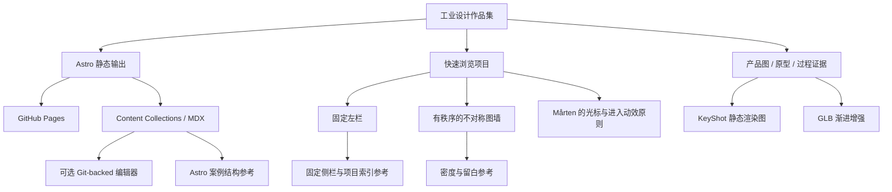

# Project memory graph

这份图谱记录决策之间的关系，避免后续迭代重复推翻已经验证的约束。

## 当前稳定决策

- 保留 Astro + GitHub Pages，不更换到服务端框架。
- 首页使用固定左栏和 3 列有序不对称图墙。
- 主图是产品视觉，文字只做辅助元数据。
- GLB 不是项目内容的唯一入口。
- 先使用本地 token 和数据文件，真实项目增加后迁移 MDX。

## 尚未决策

- GitHub Pages 的最终用户名、仓库名和 `base`。
- 真实 KeyShot 图片的命名和裁切比例。
- 是否需要 Keystatic；只有当 Markdown/MDX 编辑流程不足时再引入。
- 是否加入深色主题；当前浅色纸张系统优先。
